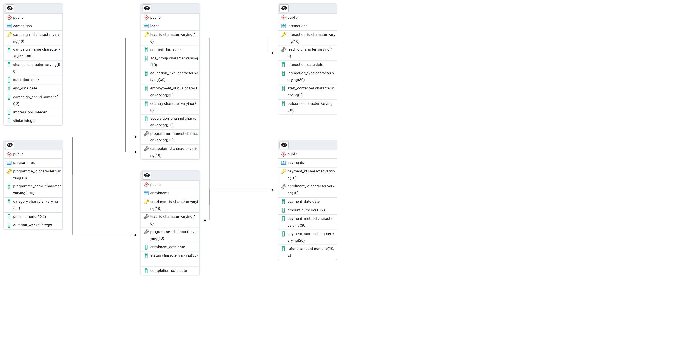

# EdTech Marketing & Enrolment Analytics

An independent, end-to-end analytics case study using **PostgreSQL, SQL and Power BI**. It explores how an EdTech organisation could use interconnected marketing, customer and enrolment data to understand **acquisition performance, conversion behaviour, programme demand and marketing efficiency**.

> **Note:** This is a portfolio project built entirely on **synthetic data**. The dataset was generated with Python for this case study. It does not come from, or describe, any real company, student or campaign, and none of the figures should be read as real business results.

---

## Project Origin

This project began with a real experience: I took part in a pay-to-participate internship. Rather than leave it as just an experience, I used it as the starting point for something I could build on as an analyst.

It is **not** an investigation of any company or programme. Instead, I asked myself:

> *"If an EdTech company had hired me as an analyst, what would they expect me to investigate, analyse and deliver?"*

I then designed a realistic business scenario, built the dataset and database, and worked through the analysis as if responding to a genuine assignment. I was not employed or commissioned by any EdTech company for this work.

---

## Business Problem

A hypothetical EdTech organisation attracts prospective students through several marketing channels, engages them through calls, emails, brochures and webinars, and tries to convert them into paying learners.

Analysing these stages separately makes it hard to see the full customer journey. This project brings them together to answer questions such as:

- How effectively are leads converting into enrolments?
- Which acquisition channels generate the most leads, and which actually convert them?
- Which programmes attract the strongest demand?
- Which customer segments perform differently?
- How efficiently is marketing spend converted into enrolments?
- Does engagement frequency or interaction type relate to conversion?
- How long does a lead typically take to enrol?
- Where does the funnel lose the most people?

---

## Data Model

Six interconnected tables represent the customer journey from marketing acquisition through engagement, enrolment and payment.



- **Campaigns**: marketing activity, channels, spend, impressions and clicks
- **Leads**: prospective students and their programme interests
- **Interactions**: engagement activity throughout the journey
- **Programmes**: education products and pricing
- **Enrolments**: conversion from leads into programme enrolments
- **Payments**: revenue, payment status and refunds

| Table | Rows |
|---|---:|
| `programmes` | 5 |
| `campaigns` | 40 |
| `leads` | 20,000 |
| `interactions` | 35,249 |
| `enrolments` | 1,712 |
| `payments` | 1,712 |

Leads were created between January 2024 and December 2025. Enrolments run to early February 2026, so the final month is incomplete.

### How the data was generated

The data is random but not patternless. The generator sets a different conversion probability for each channel (Referral 15%, University Partnership 12%, LinkedIn 7%, Google Ads 6%, Meta Ads 5%), while interaction type, interaction count and age group have no direct effect on conversion. Channel differences in the results therefore reflect how the data was built. The purpose of the project is to demonstrate analytical method, not to claim discoveries about real student behaviour.

---

## Analytical Workflow

```text
Synthetic Business Data (Python)
        │
        ▼
Relational Database (PostgreSQL)
        │
        ▼
Data Quality &
Referential Integrity Checks
        │
        ▼
SQL Business Analysis
        │
        ├── Acquisition & Conversion
        ├── Programme Performance
        ├── Customer Segmentation
        ├── Marketing Efficiency & ROI
        ├── Engagement Analysis
        └── Conversion Speed & Funnel
        │
        ▼
Reusable SQL Views
        │
        ▼
Power BI Dashboard
```

---

## Database & Data Quality

Before the business analysis, SQL checks assessed:

- Duplicate primary keys
- Orphan records across all six foreign-key relationships
- Missing values in critical fields
- Logical consistency (e.g. enrolments before lead creation, payments before enrolment, negative or zero amounts)
- Categorical consistency and valid ranges (e.g. clicks exceeding impressions, end dates before start dates)

No issues were found. Because the data was generated cleanly, these checks mainly demonstrate validation method rather than uncovering real-world data problems.

---

## Business Analysis

### Acquisition & Conversion
Compares channels by lead volume, enrolments and conversion rate, to separate channels that generate traffic from those that generate customers.

### Programme Performance
Compares enrolment performance across the five programmes.

### Customer Segmentation
Examines conversion across age group, education level and employment status, beyond company-level averages.

### Marketing Efficiency & ROI
Evaluates Cost per Lead, Cost per Enrolment, revenue and ROI, calculated as `(Revenue − Spend) / Spend × 100`.

### Engagement & Conversion Speed
Compares conversion by interaction frequency and interaction type, and measures days from lead creation to enrolment.

### Conversion Funnel
Tracks Leads → Engaged Leads → Enrolments → Successful Payments → Completed Programmes.

---

## Power BI Dashboard

Nine reusable views in `sql/04_powerbi_views.sql` separate the analytical layer from the presentation layer. They feed a three-page interactive Power BI dashboard.

| Page | Focus |
|---|---|
| **1. Executive Overview** | Leads, enrolments, conversion rate, revenue, marketing spend, attributed revenue, ROI, cost per enrolment, monthly trends |
| **2. Marketing & Acquisition Performance** | Leads and conversion by channel, campaign spend, clicks, impressions, CTR, CPC, revenue per enrolment by programme |
| **3. Lead Behaviour & Conversion Analytics** | Conversion by age group, engagement frequency and interaction type, average days to enrolment, conversion outcomes |

<!-- Add dashboard screenshots here, e.g.  -->

---

## Key Results (Simulated Data)

| Metric | Value |
|---|---:|
| Total leads | 20,000 |
| Total enrolments | 1,712 |
| Lead conversion rate | 8.56% |
| Revenue (successful payments) | £766,565 |
| Campaign spend | £117,122.99 |
| Revenue per enrolment | £447.76 |
| Average days from lead to enrolment | 22.8 |

**What the analysis shows**

- **Channel quality differs from lead volume.** LinkedIn generates the most leads (6,010) but converts at 7.59%. Referral (13.30%) and University Partnership (11.66%) convert at roughly twice the rate of Google Ads (5.98%) and Meta Ads (5.74%).
- **Programme differences are narrow.** Business Analytics converts highest (8.96%) and Data Analytics lowest (7.77%).
- **Engagement shows limited differentiation.** Leads with no interactions convert lowest (7.63%), but conversion among engaged leads stays between about 8.2% and 8.9% with no consistent rise as interactions increase. Interaction types sit within a narrow band of roughly 8.5% to 8.8%.
- **Age group differences are small**, from 8.07% (31+) to 9.15% (26–30).
- **Funnel:** 1,712 enrolments led to 1,535 successful payments and 1,108 completed programmes.

---

## Limitations & Assumptions

- **ROI is based on attributed revenue.** The headline ROI of **248.13%** compares attributed revenue (£407,735) with total campaign spend (£117,123). Referral and University Partnership leads are not linked to campaigns, so their revenue (£358,830 from 809 enrolments) is not attributed, although their campaign spend (£53,097) is included. In the ROI view these two channels therefore show −100%, which reflects the attribution gap rather than real performance.
- **Paid channels only:** for Google Ads, LinkedIn and Meta Ads, spend of £64,026 against attributed revenue of £407,735 gives an ROI of about 537%.
- **Cost per enrolment (£68.41)** divides all spend by all 1,712 enrolments. Using only the 903 attributed enrolments, it would be about £129.70.
- **Enrolments include refunded and failed payments;** revenue counts successful payments only.
- **Advertising metrics are not realistic.** Click-through rates are far above real-world norms, and impressions and clicks appear for Referral and University Partnership campaigns. These come from the data generator.
- **Interaction types overlap,** because a lead can have several types.
- **Synthetic data:** findings illustrate analytical method and should not be generalised to real organisations.

---

## Tech Stack

| Area | Technology |
|---|---|
| Database | PostgreSQL 17, pgAdmin 4 |
| Querying & Analysis | SQL (joins, CTEs, conditional aggregation, `FILTER`, `PERCENTILE_CONT`, views) |
| Data Generation | Python (pandas, NumPy) |
| Data Quality | SQL validation & integrity checks |
| Business Analytics | Funnel, KPI, marketing efficiency & ROI analysis |
| Visualisation | Power BI |

---

## Repository Structure

```text
edtech-analytics/
│
├── README.md
│
├── data/
│   ├── 01_generate_synthetic_data.ipynb
│   ├── campaigns.csv
│   ├── enrolments.csv
│   ├── interactions.csv
│   ├── leads.csv
│   ├── payments.csv
│   └── programmes.csv
│
├── sql/
│   ├── 01_database_schema.sql
│   ├── 02_data_quality_checks.sql
│   ├── 03_analysis.sql
│   └── 04_powerbi_views.sql
│
└── powerbi/
    └── edtech_analytics_dashboard.pbix
```

---

## Project Scope

This is a **portfolio case study using synthetic data**, designed to show how I would approach a realistic analyst assignment:

**business problem → data modelling → data-quality validation → SQL analysis → KPI development → dashboard reporting**

The business scenario, dataset and all results are simulated, and the project is not affiliated with any company.
